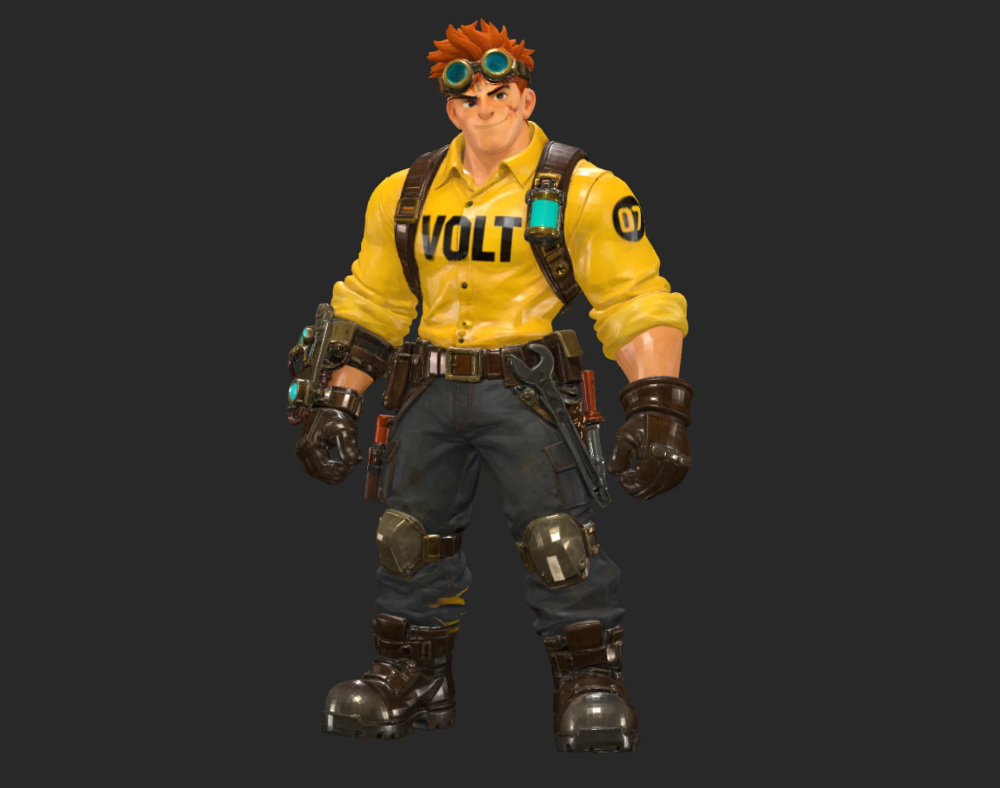

# UltraTex for ComfyUI - Free 2K AI Textures, Local (6-16 GB GPUs)

Textures any untextured mesh from **one reference image**: readable text and logos, PBR (metallic-roughness), and a one-click installer for Windows.



## Which workflow for my GPU?

| Workflow | Best for | Nodes |
|---|---|---|
| **1 Standard 6 views + PBR** | 12-16 GB, start here | [visualbruno](https://github.com/visualbruno/ComfyUI-UltraTex) |
| **2 Advanced 10 views + PBR** | final characters, sides/arms | [visualbruno](https://github.com/visualbruno/ComfyUI-UltraTex) |
| **3 Low VRAM (GGUF)** | 6-8 GB | [MostAadTech](https://github.com/Mstafa-awad/UltraTex-ComfyUI-nodes) |

## Install

### a) Recommended: ComfyUI-Easy-Install

1. Install [ComfyUI-Easy-Install](https://github.com/Tavris1/ComfyUI-Easy-Install) if you don't have it yet. My **[installation guide](https://go.pixel-artistry.com/Trellis2InstallationGuide)** walks you through every step.
2. On this page: **Code → Download ZIP**.
3. Unzip it into `ComfyUI-Easy-Install\Add-Ons\`. You get `Add-Ons\PixelArtistry-UltraTex-main\` with `Install-UltraTex.bat` inside. (The workflows are built into the installer, so the `.bat` on its own directly in `Add-Ons` works too.)
4. Close ComfyUI.
5. Double-click `Install-UltraTex.bat`.

### b) Other ComfyUI portable installs

Put the unzipped folder next to `python_embeded` and run `Install-UltraTex.bat` there.

### What the installer does

- Installs the nodes at the tested, pinned versions: visualbruno `8137da5`, MostAadTech `8d434a2`.
- Installs the Python packages.
- Checks Triton with a real test: it runs the sparse-attention kernel UltraTex uses on your GPU once.
- Scans `ComfyUI\models` **and** `extra_model_paths.yaml`, so linked model folders (e.g. from Easy-Models-Linker) count.
- Lists the missing models and **asks** before downloading anything.
- Optional low-VRAM version: asks Y/N.
- Puts my 3 workflows (built into the installer) into `ComfyUI\user\default\workflows\PixelArtistry`, so they show up in the workflow sidebar in the **PixelArtistry** folder as `PixelArtistry_UltraTex_01_Standard_6views_PBR`, `..._02_Advanced_10views_PBR` and `..._03_LowVRAM_GGUF` (workflow 3 only if you said Y to the low-VRAM version). On a re-run, a workflow that differs from the current one is replaced, and your old file is kept next to it as `.bak`.
- Safe to re-run: existing files are skipped, unfinished downloads resume.

**Requirements:** Windows, NVIDIA GPU, a recent ComfyUI (Oct 2026), ~25 GB disk for the fp8 models, ~11 GB extra for the GGUF version.

> [!NOTE]
> The fp8 model is gated on Hugging Face. Accept the license on [black-forest-labs/FLUX.2-klein-base-9b-fp8](https://huggingface.co/black-forest-labs/FLUX.2-klein-base-9b-fp8) and create a free **Read** token at [huggingface.co/settings/tokens](https://huggingface.co/settings/tokens). The installer asks for it. License details: see [License](#license) at the bottom.

### c) Manual install

No installer, step by step. Paths assume a portable ComfyUI (the folder that contains `python_embeded` and `ComfyUI`).

**1. Nodes** - open a terminal in `ComfyUI\custom_nodes`:

```bash
git clone https://github.com/visualbruno/ComfyUI-UltraTex
cd ComfyUI-UltraTex
git checkout 8137da5
```

This is the tested version. Newer versions may work, but I haven't tested them.

**2. Python packages** - from the folder that contains `python_embeded`:

```bash
.\python_embeded\python.exe -m pip install -r ComfyUI\custom_nodes\ComfyUI-UltraTex\requirements.txt
```

Non-portable installs: use the python of your ComfyUI environment.

**3. Triton** (optional for workflows 1/2, **required** for workflow 3)

ComfyUI-Easy-Install already includes it. Otherwise install [triton-windows](https://github.com/woct0rdho/triton-windows) matching your PyTorch version, e.g. for PyTorch 2.8:

```bash
.\python_embeded\python.exe -m pip install "triton-windows<3.5"
```

**4. Models**

> [!WARNING]
> Both LoRAs are called `dit_lora.safetensors` on ModelScope. **Rename each one right after downloading**, or the second one overwrites the first. The workflows expect exactly the names in this table.

ModelScope page: [Yibo-Zhang/UltraTex](https://www.modelscope.ai/models/Yibo-Zhang/UltraTex)

| File | Folder | Source |
|---|---|---|
| `flux-2-klein-base-9b-fp8.safetensors` | `models/diffusion_models` | [black-forest-labs/FLUX.2-klein-base-9b-fp8](https://huggingface.co/black-forest-labs/FLUX.2-klein-base-9b-fp8) (accept the license first) |
| `qwen_3_8b_fp8mixed.safetensors` | `models/text_encoders` | [Comfy-Org/flux2-klein-9B](https://huggingface.co/Comfy-Org/flux2-klein-9B/resolve/main/split_files/text_encoders/qwen_3_8b_fp8mixed.safetensors) |
| `flux2-vae.safetensors` | `models/vae` | [Comfy-Org/flux2-dev](https://huggingface.co/Comfy-Org/flux2-dev/resolve/main/split_files/vae/flux2-vae.safetensors) |
| `birefnet.safetensors` | `models/background_removal` | [Comfy-Org/BiRefNet](https://huggingface.co/Comfy-Org/BiRefNet/resolve/main/background_removal/birefnet.safetensors) |
| `ultratex_flux2.safetensors` | `models/loras` | ModelScope Yibo-Zhang/UltraTex: `flux2/lora/dit_lora.safetensors` → **rename** |
| `ultratex_flux2_mr.safetensors` | `models/loras` | ModelScope Yibo-Zhang/UltraTex: `flux2_mr/lora/dit_lora.safetensors` → **rename** |
| `ultratex_flux2_decoder.pt` | `models/ultratex` (create it) | ModelScope Yibo-Zhang/UltraTex: `flux2/decoder.pt` → **rename** |

It must be Klein **base** 9B. The normal (distilled) Klein 9B doesn't work with UltraTex.

**5. Low-VRAM version** (only for workflow 3)

```bash
cd ComfyUI\custom_nodes
git clone https://github.com/Mstafa-awad/UltraTex-ComfyUI-nodes comfyui_ultratex_modular
cd comfyui_ultratex_modular
git checkout 8d434a2
```

Then from the folder that contains `python_embeded`:

```bash
.\python_embeded\python.exe -m pip install -r ComfyUI\custom_nodes\comfyui_ultratex_modular\requirements.txt "gguf>=0.13"
```

Plus [ComfyUI-GGUF](https://github.com/city96/ComfyUI-GGUF) if you don't have it yet.

Extra models:

| File | Folder | Source |
|---|---|---|
| `flux-2-klein-base-9b-Q4_0.gguf` | `models/diffusion_models` | [unsloth/FLUX.2-klein-base-9B-GGUF](https://huggingface.co/unsloth/FLUX.2-klein-base-9B-GGUF/resolve/main/flux-2-klein-base-9b-Q4_0.gguf) |
| `Qwen3-8B-Q4_K_M.gguf` | `models/text_encoders` | [unsloth/Qwen3-8B-GGUF](https://huggingface.co/unsloth/Qwen3-8B-GGUF/resolve/main/Qwen3-8B-Q4_K_M.gguf) |

> [!NOTE]
> Install this node pack only **once**. Two copies (e.g. one cloned under its repo name, one as `comfyui_ultratex_modular`) conflict.

**6. Workflows** - drag the JSONs from the `workflows` folder onto the ComfyUI canvas, or copy them into `ComfyUI\user\default\workflows\PixelArtistry` (create the folder) to see them in the sidebar's **PixelArtistry** folder.

**7. Restart ComfyUI.** On the first run, check the console for `UltraTex LoRA ... layers patched of N` for **both** LoRAs.

## Do I need Trellis2?

No. UltraTex **textures** meshes, it doesn't make them. Trellis2 / Pixal3D are optional, only for generating the mesh. Any untextured GLB, OBJ or PLY works, including your own sculpt.

If you want to generate meshes too: [TRELLIS.2 Installation Guide](https://go.pixel-artistry.com/Trellis2InstallationGuide)

Tested on a clean ComfyUI-Easy-Install without Trellis2: [RESULT]

## The three workflows

All three paint the texture from one front reference image. No text prompt: UltraTex only listens to the image, the prompt stays empty. Results go to `ComfyUI/output/UltraTex/` (workflows 1/2) or `output/ultratex/` (workflow 3), plus a 3D preview in ComfyUI.

### 1 · Standard 6 views + PBR

The fastest one, works on most objects. **Start here.** Six cameras paint the albedo, a second pass with the metallic-roughness LoRA paints the MR maps, and the bake writes a textured GLB plus albedo and ORM PNGs (G = roughness, B = metallic).

| Setting | Where | Value |
|---|---|---|
| Albedo resolution | Sampler · Albedo | 1024 for tests, 2048 for finals (2048 takes ~4× as long) |
| UV unwrap | Prep · uv_mode | `comfy_gpu`, or `keep_existing` for your own UVs |
| Texture size | Bake · texture_size | 2048 |
| VRAM | - | the fp8 model alone is ~9 GB, tested on 16 GB cards |

### 2 · Advanced 10 views + PBR

Same as Standard, plus a **second pass with 4 cameras at 45°**. Fixes smears where 6 cameras only see the surface at a steep angle: sides of arms, belts, holsters, shoulder pads. Use it for final characters. For quick tests and simple shapes, workflow 1 is enough.

| Setting | Where | Value |
|---|---|---|
| Resolution | Pass 1, Render Views, Pass 2 | the **same** value on all three: 1024 tests, 2048 finals |
| Pass 2 strength | Pass 2 · denoise | 0.6 (lower = keeps more of pass 1) |
| Keep threshold | Render Views · keep_above | 0.75 (≈ seen within 41° of head-on) |
| Texture size | Bake · texture_size | 2048 |

### 3 · Low VRAM (GGUF)

The same UltraTex texturing rebuilt for 6-8 GB GPUs by MostAadTech: Q4 GGUF Klein base model, Q4_K_M GGUF Qwen3 text encoder, sparse attention, tiled decoding, disk-backed caching. **Needs Triton**, no fallback. All quality and speed settings live on the two Generate nodes.

| Setting | Albedo | MR | Notes |
|---|---|---|---|
| `view_resolution` | 1024 | 1024 | 6 GB: 1024 · 8 GB: up to 1536-2048 (reported by MostAadTech) |
| `view_count` | 12 | 6 | 12 = 6 + a guided 45° pass |
| `steps` | 4 | 4 | the speed lever; 4 is a preview, use 25 for final quality |
| `texture_size` (Bake) | 2048 | | 4096 for hero assets: same VRAM, slower bake |

Keep the same seed on both Generate nodes. `tiled_decode` stays on for low VRAM.

## My measured results

RTX 5080 16 GB, 4.1M-face character, 1024 views. Measured by me:

- **Workflow 1, 25 steps:** 432 s total on the first run (incl. warm-up). Albedo 203 s, MR 89 s, GPU UV unwrap of 4.1M faces 17.7 s.
- **Workflow 2:** the second pass adds ~32 s (11 steps). Surface seen by a camera: 86.4% → 92.8%.
- **Workflow 3** (Klein Q4_0 + Qwen3 8B Q4_K_M, 4 steps, 12+6 views): 229 s with node pack `b98f4f4`; Klein 5.5 GB + text encoder 6.8 GB loaded on a 16 GB card. With the current pinned version `8d434a2` and its new Fast Surface Texture Baker: 240 s, first run after a ComfyUI restart.

Reported by the community (not measured by me):

- Runs on a 6 GB GPU at 1024.
- 6.8 GB VRAM at 1536 on an 8 GB laptop (reported by MostAadTech).

## Tips

More details and fixes: [docs/TROUBLESHOOTING.md](docs/TROUBLESHOOTING.md)

- **Reference image:** a front view, ideally the image the mesh was made from. Any background works, BiRefNet removes it.
- **Text and logos** only come out clean if they're sharp in the reference, on the front.
- **Your own UVs:** Prep `uv_mode = keep_existing` (workflows 1/2) / UV unwrap `uv_mode = keep_existing` (workflow 3). One mesh, one material, UVs in 0-1, no overlapping or mirrored islands.
- **Big meshes:** decimate to 0.5-1M faces. Faster, and fewer UV seams.
- **Workflow 3:** the node warns "4 steps is a preview". Use 25 for final quality.
- **Workflow 3 uses the Qwen3 Q4_K_M text encoder on purpose:** UltraTex runs with an empty prompt, so the smaller quant saves ~1.5 GB VRAM at no visible cost. Q6_K works too if you already have it.

## Credits & links

- UltraTex paper (SIGGRAPH Asia 2026): [yiboz2001.github.io/UltraTex](https://yiboz2001.github.io/UltraTex/)
- UltraTex weights: [ModelScope Yibo-Zhang/UltraTex](https://www.modelscope.ai/models/Yibo-Zhang/UltraTex)
- [visualbruno/ComfyUI-UltraTex](https://github.com/visualbruno/ComfyUI-UltraTex) - nodes for workflows 1 and 2
- [MostAadTech/UltraTex-ComfyUI-nodes](https://github.com/Mstafa-awad/UltraTex-ComfyUI-nodes) - low-VRAM nodes for workflow 3 (GPL-3.0)
- [FLUX.2 Klein base 9B](https://huggingface.co/black-forest-labs/FLUX.2-klein-base-9B) by Black Forest Labs
- GGUFs: [unsloth/FLUX.2-klein-base-9B-GGUF](https://huggingface.co/unsloth/FLUX.2-klein-base-9B-GGUF) and [unsloth/Qwen3-8B-GGUF](https://huggingface.co/unsloth/Qwen3-8B-GGUF)
- [ComfyUI-GGUF](https://github.com/city96/ComfyUI-GGUF) by city96
- [BiRefNet](https://huggingface.co/Comfy-Org/BiRefNet) by Comfy-Org
- [ComfyUI-Easy-Install](https://github.com/Tavris1/ComfyUI-Easy-Install) by Tavris1 / ivo (Pixaroma Community Edition)

**PixelArtistry:**

- YouTube: [youtube.com/@PixelArtistry_](https://www.youtube.com/@PixelArtistry_)
- FutureFrames newsletter: [go.pixel-artistry.com/newsletter](https://go.pixel-artistry.com/newsletter)
- Workflow Pack waitlist: [go.pixel-artistry.com/Trellis2WorkflowPackWaitlist](https://go.pixel-artistry.com/Trellis2WorkflowPackWaitlist)

## License

> [!IMPORTANT]
> - **My files in this repo** (installer, workflow layouts and notes): [MIT](LICENSE).
> - **UltraTex code and visualbruno's node pack:** MIT. **MostAadTech's node pack:** GPL-3.0 (since v2.0, MIT before).
> - **The model FLUX.2 Klein base 9B** (and its GGUF versions) is under the **FLUX Non-Commercial License v2.1** by Black Forest Labs.
> - **Your textures are yours:** BFL claims no ownership of outputs. The license lets you use outputs for any purpose, including commercial, except training a model that competes with FLUX.
> - **Running the model itself** is licensed for non-commercial use. For client or production work, check [bfl.ai/licensing](https://bfl.ai/licensing) first. This is not legal advice.
